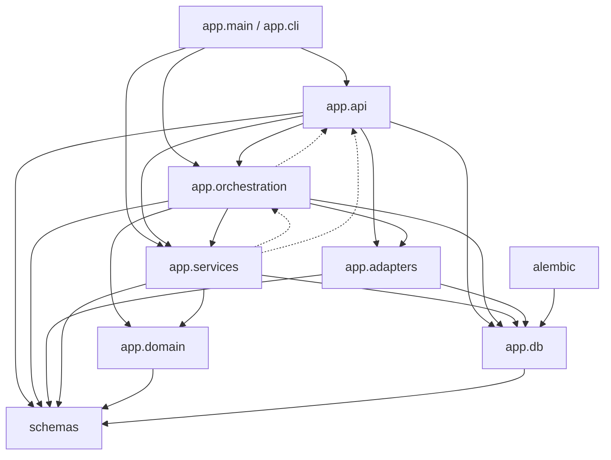
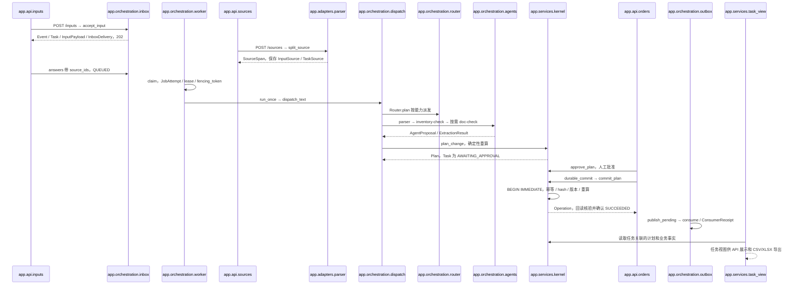
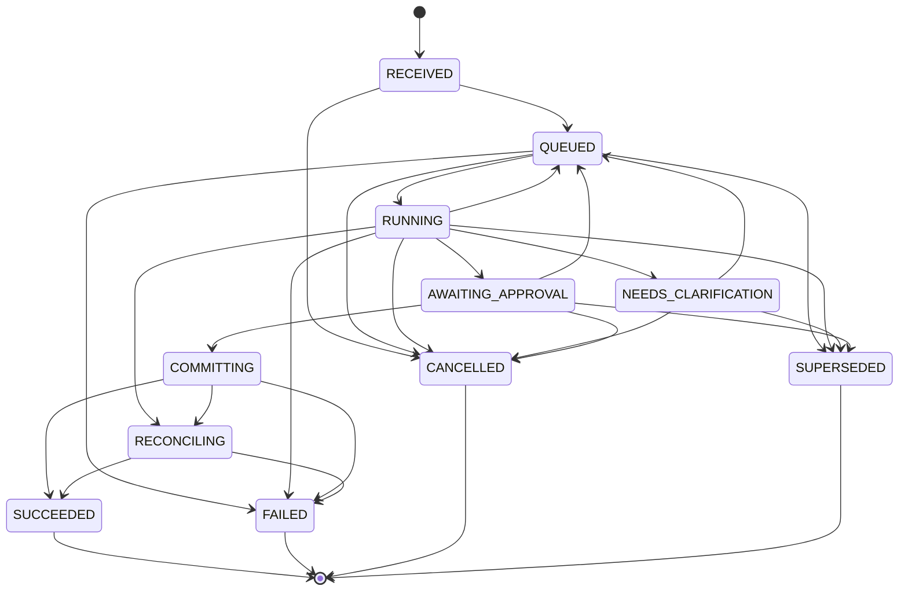

# 当前整体架构

## 1. 概述与阅读指引

OrderOps SuperAgent 是服装批发订单变更的协调层：子 Agent 提议，确定性内核预检，人工批准后在 SQLite 沙箱提交。

`docs/ARCHITECTURE.md` 是从 Stage 0 起逐条追加的决策记录，保留当时的阶段描述；本文说明当前代码的整体架构。
README 和部分模块注释也保留了早期阶段文字，判断已实现能力应以路由和函数实现为准。

建议先读本文的数据流，再沿模块表进入实现，最后结合以下文档理解契约和边界：

- [阶段决策记录](docs/ARCHITECTURE.md)
- [API 契约](docs/API.md)
- [子 Agent 契约](docs/SUBAGENTS.md)
- [已知限制](docs/KNOWN_LIMITATIONS.md)
- [Live 评测记录](docs/LIVE_EVAL.md)
- [测试清单](docs/TEST_CHECKLIST.md)

本文不将既有 live 评测当成离线 fixture 的结果，也不要求运行模型来阅读或验证架构。

## 2. 模块划分与依赖

| 模块 | 当前职责 | 关键文件 |
|---|---|---|
| app/api | HTTP 输入、来源、业务动作、任务查询和下载 | `app/api/inputs.py`、`app/api/sources.py`、`app/api/orders.py`、`app/api/tasks.py` |
| app/adapters | 静态文件切分、fixture/live 客户端、严格解析和预算账本 | `app/adapters/parser.py`、`app/adapters/uploads.py`、`app/adapters/llm.py`、`app/adapters/live_model.py`、`app/adapters/budget.py` |
| app/orchestration | 输入持久化、按能力路由、执行轨迹、租约、恢复和投递 | `app/orchestration/inbox.py`、`app/orchestration/router.py`、`app/orchestration/dispatch.py`、`app/orchestration/worker.py` |
| app/services | 预检、批准、原子提交、核验、任务投影、导出和 seed | `app/services/kernel.py`、`app/services/task_view.py`、`app/services/export.py`、`app/services/seed.py` |
| app/domain | 订单数量规则、库存不变量、下游影响、规范哈希 | `app/domain/changes.py`、`app/domain/inventory.py`、`app/domain/orders.py`、`app/domain/downstream.py`、`app/domain/hashing.py` |
| app/db | ORM 表、精确金额类型、会话、SQLite 事务和迁移入口 | `app/db/models.py`、`app/db/types.py`、`app/db/session.py`、`app/db/schema.py` |
| schemas | Pydantic 请求、响应、业务事件、提案和任务视图契约 | `schemas/api.py`、`schemas/business.py`、`schemas/subagent.py`、`schemas/catalog.py`、`schemas/task_view.py` |
| alembic | 初始结构与后续增量迁移 | `alembic/versions/3e057b273982_initial_schema.py`、`alembic/versions/durable_stage2.py`、`alembic/versions/source_stage3.py` |

`app/main.py` 的 `create_app` 装配路由、Settings、注册表和会话工厂。
`app/config.py` 集中配置，`app/errors.py` 定义稳定业务异常，`app/cli.py` 提供本地命令。
`schemas/common.py` 的 `ApiModel` 使用 `extra="forbid"`，契约版本为 `schema_version="1.0"`。
`schemas/catalog.py` 为注册表提供 schema 名称与版本检查。

导入关系已用 `rg -n '^(from|import) ' app` 检查，并检查函数内延迟 import：

- API 导入 orchestration、services、adapters、db、schemas、config 和 errors。
- orchestration 导入 adapters、services.kernel、domain、db、schemas、config 和 errors。
- services.kernel 导入 domain、db、schemas、errors，以及 seeds 的仓库常量。
- adapters 的 live_prompts 和 budget 直接导入 db；文件 parser 依赖 uploads。
- db.models 依赖 schemas.enums，db.types 负责 Decimal 字符串存储。
- domain 仅依赖自身模块、schemas.enums 和 errors，没有导入 services 或 orchestration。
- schemas 内部互相引用，不导入 app；迁移依赖 SQLAlchemy/Alembic，初始迁移还引用 db.types。

现状例外：这不是严格的单向分层。
`app/services/kernel.py` 导入 orchestration.state 的 `enforce`、`transition`。
`app/services/task_view.py` 导入 orchestration.inbox/state；`task_spans` 位于 `app/services/source_spans.py`。
inbox 导入 kernel 的公开函数 `invalidate_order`，形成包层双向依赖。

下图箭头表示 import 方向，虚线强调现状例外，不表示网络调用：

业务实现集中在 `app/services/kernel.py`。

## 3. 从输入到提交的数据流

### 接收与证据

1. `POST /inputs` 调用 `accept_input`，一个 `begin_immediate` 事务保存输入和任务，返回 HTTP 202。
   `Event` / `event` 记录投递身份，`Task` / `task` 记录业务进度。
   `InputPayload` / `input_payload` 保存 text、source_ids、input_sequence。
   `InboxDelivery` / `inbox_delivery` 的 consumer 为 worker，初始为 PENDING。
2. `(thread_id, source_event_key)` 唯一，client_event_key 成为 source_event_key。
   重复投递返回原任务；相同文字使用新 key 则是新事件。
   已选择订单的接收事务递增 intent_revision，并使旧计划与批准失效。
3. worker 的 `claim` 从 QUEUED 任务创建 `JobAttempt`，进入 RUNNING。
   领取时记录 lease_owner、lease_until 和 fencing_token，结果写入前再检查租约与 token。
4. 文件通过 `POST /sources` 的 multipart task_id + file 上传，任务必须先存在。
   `split_source` 将 UTF-8 TXT/MD 非空行或 XLSX 单元格切成 `SourceSpan` / `source_span`。
   `InputSource` / `input_source` 保存哈希、原名、storage_ref 等，原文件另存服务端临时目录。
   `TaskSource` / `task_source` 将文件绑定任务，上传本身不启动 worker。
5. 有文件的受控流程可先让任务等待澄清，再上传，再用 `POST /tasks/{task_id}/answers`
   携带新 client_event_key、完整文本及 source_ids，使同一任务回到 QUEUED。
   上传和 worker claim 不是必须按固定先后执行的串行流水。

### 路由、提案与预检

`dispatch_text` 复用持久任务；同步 `POST /dispatch` 则自行创建任务和 attempt。
`Router.plan` 按 input_mode 选择 parse.text/chat/md/xlsx 能力，注册表解析实际 Agent。
`run_parser` 经 `FixtureLLMClient` 精确匹配整段文字，或经 `LiveLLMClient` 得到严格 JSON 意图。
fixture 未命中报 FIXTURE_NOT_FOUND，不自动切换 live。

`ExtractionResult` 携带来源、问题及 `BusinessEvent`。
选中的 source_ids 通过 `task_spans` 校验归属，再参与 `compare_sheet_quantities`。
聊天与表格数量冲突时持久化双来源、conflicts 和 questions，进入 NEEDS_CLARIFICATION，不创建可提交计划。

新建订单需要 check.inventory；改单/取消需要 check.inventory，有下游单据才需要 check.downstream。
实际 runner 为 parser、inventory-check、doc-check，后两者是确定性只读检查。
没有下游时写 SKIPPED，原因是“无下游单据”；缺少必需能力则任务失败。
每步写 `DispatchStep` / `dispatch_step`，提案信封为 `AgentProposal`。
`accept_proposal` 核对 fencing_token 与 intent_revision，过期提案被拒绝。

`_precheck` 将结构化变更交给 kernel 的 `plan_change` 或 `plan_new_order`。
内核重新读取订单、发货、库存和下游单据，以 `evaluate_changes`、`assess_downstream` 重算。
库存或单据 Agent 给出的数值不作为内核事实。
`Plan` / `plan` 保存 normalized_changes、source_refs、依赖版本和 plan_hash。
合法计划为 VALIDATED，任务为 AWAITING_APPROVAL；需问人则 NEEDS_CLARIFICATION。
缺货整单拒绝，可能保存 `PurchaseProposal` / `purchase_proposal`，不会自动采购或预占。

### 批准、提交与回读

`POST /plans/{plan_id}/approve` 调用 `approve_plan`，创建 `Approval` / `approval`。
actor 来自服务端 `DEMO_ACTOR_ID="demo-user"`，默认有效期 approval_ttl_seconds=600 秒。
批准绑定 plan_hash、intent_revision、dependencies_hash；疑似重复订单要求 acknowledge_duplicate。

`POST /plans/{plan_id}/commit` 经 `durable_commit` 调用 kernel 的 `commit_plan`。
写事务用 BEGIN IMMEDIATE，在读取依赖前获得 SQLite 写锁：

- 优先查询 `Operation` / `operation` 的唯一 idempotency_key。
  同 key 同 request_hash 返回原结果，同 key 换请求返回 IDEMPOTENCY_CONFLICT。
- 核对批准身份、有效期、状态、任务取消标志、意图、订单/库存/单据版本。
- 重算库存和下游影响，重新生成 plan_hash，和计划及批准双方比较。
- 任务进入 COMMITTING，新增 `OrderRevision` / `order_revision` 与 `OrderLine` / `order_line`。
- 更新 `SalesOrder` / `sales_order` 当前版本，原子调整 `Reservation` / `reservation`、
  `StockBalance` / `stock_balance`，追加 `StockMovement` / `stock_movement`。
- 同事务更新下游，追加 `DocRevision` / `doc_revision`、`DownstreamLink` / `downstream_link`、
  `AuditRecord` / `audit_record`、Operation、order.committed Event 及 `OutboxDelivery` / `outbox_delivery`。
  批准变为 CONSUMED，计划变为 COMMITTED；异常回滚整个业务事务。

提交后 `_post_verify` 回读库存流水和下游一致性；失败只标 committed_verification_pending，不改写业务历史。
`acknowledge_commit` 将任务置 SUCCEEDED；响应丢失可进入 RECONCILING，用原请求和原 key 对账。
`publish_pending` 至少一次发送，失败按 available_at 退避，发送成功后标 DELIVERED。
`consume` 在同一事务执行本地 effect 并写 `ConsumerReceipt` / `consumer_receipt`，
以 `(event_id, consumer)` 主键去重；默认只写 receipt，尚无浏览器实时推送。

`build_task_view` 提供任务卡、调度、差量、下游、来源、批准区和结果。
`GET /tasks/{task_id}/view` 返回 JSON，`GET /ui/tasks/{task_id}` 渲染 HTML。
`GET /tasks/{task_id}/download?fmt=csv` 或 fmt=xlsx 调用 `export_change_list`。
已提交差量来自基础与已提交修订，任务模式依据 ModelUsage 是否存在判定 FIXTURE/LIVE。

## 4. 持久化执行与恢复

Task 表示跨重启保存的业务进度；JobAttempt 表示一次执行所有权。
`app/orchestration/worker.py` 的 `Limits` 默认值如下：

| 字段 | 默认值 | 含义 |
|---|---|---|
| active | 2 | 同时 RUNNING 上限，claim 还取 min(2, limits.active) |
| lease_seconds | 60 | 领取与 heartbeat 续租秒数 |
| progress_seconds | 120 | watchdog 判断无进展的秒数 |
| attempts | 3 | 每任务最多 attempt 次数 |
| steps | 8 | attempt 步数上限 |

`claim` 用短写事务选 QUEUED，每次接管递增 attempt_no 和 fencing_token。
`heartbeat` 更新 heartbeat_at 与 lease_until，progress=True 时还更新 last_progress_at 并加 step_count。
调度步骤完成也更新进展；等待人工后释放租约，不让等待占据 RUNNING 名额。
`check_fence` 要求任务仍 RUNNING，最新 attempt 的 token 相同且 lease_until 未过期。
`guard` 将任务/token/时钟绑定执行上下文，`enforce` 在实际写事务中重新校验。

取消在 `app/api/inputs.py` 的 `cancel_task` 中与提交共用 SQLite 写序列。
取消先成功时设置 cancel_requested、清租约，提交返回 CANCELLED。
COMMITTING、RECONCILING、SUCCEEDED 返回 ALREADY_COMMITTED，不回滚已提交事实。
其他状态仍须遵守转换表，因此 FAILED/SUPERSEDED 的取消会报 ILLEGAL_TRANSITION。

`app/orchestration/watchdog.py` 的 `scan` 先查 Operation，再决定恢复：
已提交操作对应的任务经 RECONCILING 到 SUCCEEDED，并补建缺失的 ui outbox。
RUNNING 租约过期、无进展或到期时可重新排队；截止或尝试/步数耗尽则 FAILED。
`app/orchestration/recovery.py` 的 `durable_commit` 处理提交成功但确认丢失的边界。
当前不是常驻 worker；`python -m app.cli worker-once` 依次执行迁移、scan、run_once、publish_pending。

下面精确列出 `app/orchestration/state.py` 的 `ALLOWED` 全部转换。
终态 SUCCEEDED、FAILED、CANCELLED、SUPERSEDED 的允许目标集合为空。
图中初始/结束箭头仅用于展示，不属于业务转换。

## 5. 预算与调用账本

`app/adapters/budget.py` 的 `BudgetLedger.reserve` 在调用前原子预留费用和每任务调用名额，
`BudgetLedger.settle` 在同一条 ModelUsage 上以实际 token 结算，保留调用记录。
`quote_cost` 使用 Decimal，将费用量化到 0.000001 美元；`Money` 以字符串保存避免 SQLite 浮点误差。
`spent` 汇总所有用量行，`calls_for_task` 统计任务用量行数。

`HARD_BUDGET_CEILING_USD=Decimal("5.00")` 位于 `app/config.py`。
`effective_cap` 与 Settings.effective_live_budget_usd 均取配置与硬上限的较小值。
已花费 + 预估费用大于上限才拒绝，等于上限可调用；未知单价不会猜测。

输入上界 = max(request.input_tokens, UTF-8 字节数(system_prompt + user_prompt + schema JSON) + 256)。
预留费用 = (输入上界 × price_in_per_mtok + max_output_tokens × price_out_per_mtok) / 1_000_000。
默认 model_max_tokens=1000，model_timeout_s=60，model_max_calls_per_task=3。
parser 的 AgentBudget 也限定 max_tokens_per_call=1000、max_calls_per_task=3。
Agent 进程内计数限制本次调度，live 账本在写事务中检查持久调用次数。

崩溃未结算时保留悲观预留；超时、连接失败、成功响应缺有效用量也按授权估算记账。
HTTP 拒绝无有效用量时计零 token/费用，但保留调用次数；实际用量超过估算也如实结算。
详见[预算故障限制](docs/KNOWN_LIMITATIONS.md)。
fixture 只返回零费用 UsageReport，不写 model_usage，不消耗 live 预算。

## 6. 安全边界

### 不可信数据与权限

聊天、上传文本、工作表和模型输出都是数据，不能授权业务动作。
`app/adapters/live_prompts.py` 将用户内容放入 input_text/file_data，系统指令要求忽略越权要求。
严格 ParserOutput 禁止额外字段，本地 `to_extraction` 绑定来源与业务信封，模型不能自报批准、版本或 fencing。
这层提示词不替代工具白名单和内核检查；R10 验证注入文本无批准/提交副作用。

R13 的 source isolation 由 task_source 联表、`task_spans` 归属检查和 ToolGateway 范围检查实现。
服务端随机生成文件路径，不把客户端文件名当存储路径；跨任务 source_id 返回 SOURCE_NOT_FOUND。
这只是任务范围隔离，尚无生产用户认证，不能把 task_id 当身份凭据。

`app/orchestration/registry.py` 的 `FORBIDDEN_TOOLS` 明确拒绝：
`approve_plan`、`commit`、`plans.approve`、`plans.commit`、`order.commit`。
parser 仅可 source.read；inventory-check 仅可 order.get/inventory.check；
doc-check 仅可 order.get/downstream.get。ToolGateway 没有改价、任意 SQL、shell 或外传处理器。
拒绝工具写 tool.denied 审计并使步骤失败；子 Agent 不能创建批准或提交订单。
库存、单据、版本和哈希始终由 kernel 再读再算，不采信提案数值。

### 上传与导出

`app/adapters/uploads.py` 的 `ALLOWED_SUFFIXES` 仅含 .txt、.md、.xlsx。
XLSM、VBA 文件名、宏内容类型、外链目录/类型都会拒绝。
`static_workbook` 使用 data_only=False、read_only=True、keep_links=False，检查所有工作表。
公式类型或以等号开头的字符串都要求改成静态值；XML 安全异常通过 DefusedXmlException 处理。

| 常量 | 数值 |
|---|---|
| MAX_FILE_BYTES | 5 × 1024 × 1024 字节 |
| MAX_FILES | 每任务 3 个 |
| MAX_SHEETS | 5 张 |
| MAX_NONEMPTY_ROWS | 所有表合计 5000 行 |
| MAX_UNCOMPRESSED_BYTES | 25 × 1024 × 1024 字节 |
| MAX_COMPRESSION_RATIO | 200 |
| MAX_ZIP_MEMBERS | 1000 |
| MAX_CELLS | 100000 个非空单元格 |

HTTP 上传流另限制在 MAX_FILE_BYTES + 64 × 1024 字节，失败不保存部分 spans。
`app/services/export.py` 的 `sanitize_export_text` 转义公式注入前缀 =、+、-、@，
也考虑前导空白、控制字符、零宽字符和 BOM，添加单引号。
CSV 使用 UTF-8 BOM；XLSX 字符串强制文本类型，数量列只接受有限数值。

### 配置、密钥与模式

运行时密钥使用 `OOS_LLM_API_KEY`，以 SecretStr 保存，不应进入日志或响应。
代码未实现“密钥只能来自环境”的独立强制限制：Settings 默认仍配置 env_file=".env"，
也能通过构造参数注入；操作约定应只从进程环境注入密钥。
`tests/conftest.py` 在 pytest_configure 中禁用 dotenv，清理测试 OOS_ 环境和设置缓存。
live 客户端不回显上游原始正文/请求头，过滤可能回显密钥的结构化输出和错误字段。

`OOS_LLM_BASE_URL` 只允许去尾斜杠后等于 https://api.openai.com/v1，
HTTP 客户端 trust_env=False、follow_redirects=False，避免环境代理和重定向转送凭据。
`OOS_LIVE_ENABLED` 默认 false；`resolve_mode` 要求开启开关、
`OOS_PRICE_IN_PER_MTOK`、`OOS_PRICE_OUT_PER_MTOK` 和密钥，否则保持 FIXTURE。
`OOS_LLM_PROVIDER` 必须是 openai，`OOS_LLM_MODEL` 必须配置，否则 live 客户端拒绝启动。
其他主要键为 `OOS_LIVE_BUDGET_USD`、`OOS_MODEL_REASONING_EFFORT`、
`OOS_MODEL_TIMEOUT_S`、`OOS_MODEL_MAX_TOKENS`、`OOS_MODEL_MAX_CALLS_PER_TASK`、`OOS_DATABASE_URL`。
健康检查报告模式解析结果；真实任务卡依据 model_usage，而非仅凭配置显示 LIVE。

## 7. 主要错误码与 HTTP 状态

`app/api/errors.py` 将 AppError 映射为带 request_id、correlation_id、schema_version 的错误信封。
以下列代码实际定义的主要错误；调度持久化的任务错误不一定作为 HTTP 异常返回。

| 类别 | 错误码 | HTTP 状态与含义 |
|---|---|---|
| 请求 | ERROR、VALIDATION_ERROR、INVALID_INPUT | 400，通用错误、请求结构错误、缺输入 |
| 来源/导出 | UPLOAD_REJECTED、UPLOAD_LIMIT、EXPORT_REJECTED | 400，上传静态安全/数量限制或导出格式拒绝 |
| 查询 | NOT_FOUND、TASK_NOT_FOUND、SOURCE_NOT_FOUND、EXPORT_NOT_FOUND | 404，对象不存在或来源不属于任务 |
| 注册 | REGISTRY_ERROR、BAD_VERSION、EXTERNAL_NOT_ENABLED、SCHEMA_MISSING、REGISTRY_DUPLICATE、AMBIGUOUS_CAPABILITY | 500，注册配置错误，通常发生在装配/能力查找 |
| 工具 | TOOL_NOT_ALLOWED | 403，工具或范围越权 |
| 执行 | TOOL_CONTEXT_MISSING、ILLEGAL_TRANSITION、STALE_ATTEMPT、LATE_PROPOSAL、ORDER_SCOPE、STEP_LIMIT | 409，上下文、状态、租约或范围冲突 |
| 提案 | PROPOSAL_REJECTED | 409，提案 token/意图不符 |
| 解析 | FIXTURE_NOT_FOUND、SCHEMA_INVALID | 422，无 fixture 或输出结构不合法 |
| 业务 | BUSINESS_CONFLICT、SHORTAGE、EXECUTED_PORTION_IMMUTABLE、INVARIANT_6、MTO_CREATE_UNSUPPORTED、INVENTORY_INVARIANT | 422，数量/执行事实/库存约束拒绝 |
| 批准 | NOT_APPROVED | 409，计划不可批准；提交时批准或计划不存在为 404 |
| 批准 | HASH_MISMATCH、STALE_INTENT、STALE_DEPENDENCY、DUPLICATE_UNCONFIRMED、EXPIRED、APPROVAL_INVALID、CANCELLED | 409，哈希、版本、重复确认、有效期或取消冲突 |
| 批准 | APPROVAL_ACTOR_MISMATCH | 403，审批身份不同 |
| 预算 | BUDGET_EXCEEDED、CALL_LIMIT | 429，预算或调用次数耗尽 |
| live 配置 | PRICES_NOT_CONFIGURED、KEY_NOT_CONFIGURED、LIVE_DISABLED、LIVE_START_REFUSED | 503，拒绝 live 启动 |
| live 输出 | TOKEN_LIMIT、MODEL_INCOMPLETE | 422，输出上限或未完成输出 |
| live 传输 | MODEL_TIMEOUT | 504，超时且不自动重试 |
| live 传输 | MODEL_TRANSPORT、MODEL_AUTH、MODEL_RATE_LIMIT、MODEL_UPSTREAM、MODEL_HTTP | 502，连接或提供方错误，原状态在安全 details 中 |
| seed | SEED_INTEGRITY | 500，合成快照校验失败 |

TIMEOUT、CAPABILITY_MISSING、UNSUPPORTED_EVENT、DEADLINE、ATTEMPT_LIMIT 等也会写入任务或步骤，
它们不是统一具有固定 HTTP 状态的异常类；ALREADY_COMMITTED 是取消响应的状态值。
PROVIDER_UNSUPPORTED、MODEL_NOT_CONFIGURED、BASE_URL_UNSUPPORTED 是 LiveStartRefused 的 reason，
外部错误码使用 LIVE_START_REFUSED，不应把 reason 误列成独立 HTTP 错误码。

## 8. 已知限制

- 单机 SQLite 演示，无生产认证、CSRF 或多用户授权；没有真实 ERP/采购/发货接入。
- worker-once 需外部驱动，未提供常驻调度或浏览器实时事件推送。
- 上传原件在临时目录，缺少生产存储、生命周期和清理方案。
- fixture 精确匹配，静态表格仅支持明确列名布局；live 上下文仅包含限定合成主数据。
- 页面提供任务投影，完整聊天入口、任务列表和批准提交交互仍未接齐。
- 锁定量/可用量/下游状态读取当前事实，不是完整历史快照。
- live 不自动重试，崩溃保留预算预留；小样本评测不代表通用理解能力。
- 存在跨层 import 和旧占位入口，生产扩展前需明确拆分和复核事务边界。

完整范围与故障行为见[已知限制](docs/KNOWN_LIMITATIONS.md)，验收范围见[测试清单](docs/TEST_CHECKLIST.md)。
