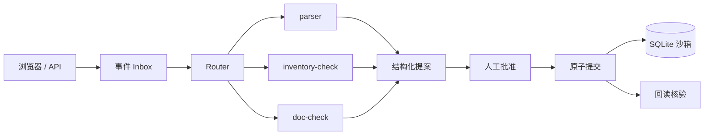

# order-ops-superagent

OrderOps SuperAgent：服装批发订单的多 Agent 调度系统，Router 分派解析、库存、单据核对子 Agent，人工审批后执行并核验。

OrderOps SuperAgent: a multi-agent coordination layer for garment-wholesale order changes.

**状态：Stage 1C（子 Agent 接口）在当前分支。** `POST /dispatch` 用 Fixture 跑 parser、inventory-check、doc-check，再进入已有的预检、批准、提交和回读核验。不调用 live 模型。持久任务和完整界面还没做。

## 架构



子 Agent 只出提案，不能批准或提交。内核在批准后的提交里重算库存和下游单据。inbox、租约和完整任务页还没接上。

## 如何运行

需要 Python 3.11 及以上。本机演示只绑定 `127.0.0.1`。

```bash
python -m venv .venv
source .venv/bin/activate
pip install -e ".[dev]"
make seed
make run
```

- 健康检查：<http://127.0.0.1:8000/health>
- 任务视图桩：<http://127.0.0.1:8000/tasks/T-STUB/view>
- 同一结构的朴素页面：<http://127.0.0.1:8000/ui/tasks/T-STUB>

等价脚本：`scripts/seed.sh`、`scripts/run.sh`、`scripts/test.sh`、`scripts/lint.sh`。

停止：在运行 `make run` 的终端按 Ctrl+C。Stage 0 没有后台 worker，也没有常驻的模型调用。

## 测试

```bash
make lint
make test
make typecheck   # mypy，配置在 pyproject.toml [tool.mypy]
make cov         # pytest + 覆盖率，低于 fail_under（90%）即失败
make check       # lint + typecheck + cov，一次跑完
```

当前 GitHub Actions 只跑 `make lint` 和 `make test`。类型检查、覆盖率和离线评测这几步写在
`ci/pending-workflow-changes.yml` 里，等仓库补上 workflow 权限后整份替换 `.github/workflows/ci.yml`。

`pytest` 会列出跳过的 B/R 用例和原因。跳过不是通过。清单在 `tests/acceptance_cases.py`。

## 数据

全部是合成数据。默认库文件是 `./data/oos.db`（WAL，另有 `oos.db-wal` / `oos.db-shm`）。清掉演示数据：

```bash
rm -f data/oos.db data/oos.db-wal data/oos.db-shm
make seed
```

`make seed` 再次执行不会复制订单。库里已经有 `SO-1001` 时会直接返回。

## Fixture 与 Live

默认 `FIXTURE`。`/health` 和任务卡都会标出模式。

Stage 4 已实现 OpenAI Responses API 的严格 JSON 解析，默认关闭。Live 需要操作者显式启用 `OOS_LIVE_ENABLED`，配置输入/输出单价、环境密钥 `OOS_LLM_API_KEY`、`OOS_LLM_PROVIDER`（openai）和 `OOS_LLM_MODEL`。缺单价或密钥时保持 FIXTURE。任务卡按实际账本标注模式，fixture 成功不算 live。

预算是配置值与 **5.00 美元** 的较小值；每次调用前用 `max(request.input_tokens, UTF-8字节数(system+user+schema JSON)+256)` 估算输入上界（覆盖中文），加上最大输出费用后熔断。`model_usage` 持久记账，超时/连接失败按授权输入估计和最大输出记账；返回的输出 token 已含推理用量。推理强度 `OOS_MODEL_REASONING_EFFORT` 默认 none；`openai` 提供方的 `OOS_LLM_BASE_URL` 只允许官方 OpenAI 地址。解析器只能提议，批准、库存、版本和 fencing 检查仍由内核负责。

手动 smoke：在操作者配置环境后运行 `.venv/bin/python scripts/live_smoke.py --out /tmp/oos_live_smoke.json`。脚本建立临时合成数据库，将本次预算限制为配置与 **1.00 美元** 的较小值，跑 14 个样本，黄金样本通过正常批准/提交 API；鉴权、限流或预算错误时提前停止。它不属于 CI，也没有在实现阶段执行真实调用。CI 只使用 fixture / MockTransport，零网络。

配置键及价格占位符见 `.env.example`；密钥只在运行时经进程环境注入，不写进 `.env`。不要把密钥写进仓库或提示词。真实模型的理解质量需由操作者手动评估。

## 替换模型

启用 Live 后，兼容 Chat（DeepSeek / vLLM / Ollama）需配置 `OOS_LLM_PROVIDER=openai_compatible`、必填的 `OOS_LLM_BASE_URL` 和 `OOS_LLM_MODEL`，并在运行时环境注入 `OOS_LLM_API_KEY`。URL 必须 HTTPS；仅主机名为 `localhost`、`127.0.0.1`、`::1` 时允许 HTTP 和免密钥，按主机名字符串判定、不做 DNS 解析。输入/输出单价 `OOS_PRICE_IN_PER_MTOK` / `OOS_PRICE_OUT_PER_MTOK` 必须明确配置，本地模型无需计费时也须显式设为 `0`。

`OOS_LLM_JSON_SCHEMA_SUPPORTED` 默认 `false`（使用 `json_object`），确认服务支持严格 `json_schema` 后才设为 `true`。启动 INFO 日志只记录 provider 和 URL 主机名。兼容 provider 不发送 `store`，是否留存数据取决于提供方政策；操作者配置的任何 HTTPS 地址都会收到 key。目前仅 mock 测试，未实测各家 `json_object` / `json_schema` 支持、usage 字段与错误体格式。详见[模型提供方](docs/MODEL_PROVIDERS.md)。

## 禁区

不连接真实 ERP、客户、支付、合同或发货接口。不公开部署。仓库保持私有，直到方案修订第 6 条的公开条件满足。批准和提交只作用于本机沙箱。

## 文档

- [方案 v1.0](docs/PLAN_v1.0_dot.md) 与 [修订 v1.1](docs/PLAN_REVISION.md)（原文）
- [架构与本阶段决策](docs/ARCHITECTURE.md)
- [接口契约](docs/API.md)
- [子 Agent 契约](docs/SUBAGENTS.md)
- [已知限制](docs/KNOWN_LIMITATIONS.md)
- [测试清单](docs/TEST_CHECKLIST.md)
