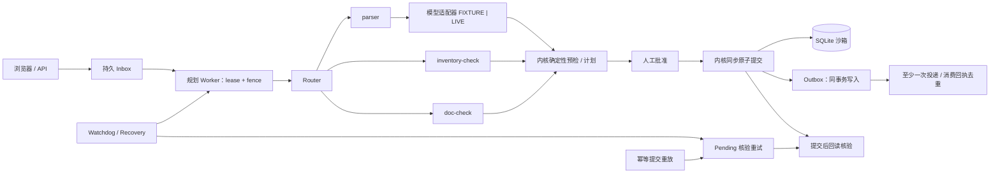

# order-ops-superagent

OrderOps SuperAgent：服装批发订单的多 Agent 调度系统，Router 分派解析、库存、单据核对子 Agent，人工审批后执行并核验。

**状态：v1.0.0 候选（1.0.0rc1）。阶段交接与后续改进已合入 main；尚未正式发布或打正式 tag，发布须等 Qi 批准。**

已接通持久 inbox、worker、子 Agent 调度、预检、人工批准、原子提交、回读核验与 pending 核验重试，并支持静态文件上传、数据库任务视图及导出。默认 FIXTURE，可显式启用受预算限制的模型解析。

## 快速上手

需要 Python 3.11 及以上。本机演示只绑定 `127.0.0.1`，无需创建 `.env`。

```bash
python -m venv .venv
source .venv/bin/activate
pip install -e ".[dev]"
make init-db
make seed
make run
```

也可在激活虚拟环境后，用锁定依赖替代上面的安装命令：

```bash
pip install -r requirements-dev.lock && pip install --no-deps -e .
```

根目录 `requirements.lock` 是运行时依赖，`requirements-dev.lock` 是运行时与开发依赖；由 `uv pip compile pyproject.toml --universal --python-version 3.11`（开发版另加 `--extra dev`）生成，`pyproject.toml` 保留顶层依赖精确版本。 应用锁文件不包含构建后端；下述 ordinary-wheel gate 单独使用 requirements-build.lock。editable 安装仍使用 `pyproject.toml` 中未完全锁定的 `setuptools>=68` / `wheel` 构建隔离依赖，因此不是完全封闭构建。

### 演示网页

激活虚拟环境、安装依赖后，运行：

```bash
make init-db && make seed && make run
```

启动会在预算预留对账前检查迁移版本、必需表和 ORM 映射列名；缺列的库即使版本标记最新也会拒绝启动，不自动修复。请检查损坏原因并从有效备份恢复，迁移仍需显式执行 `python -m app.cli init-db`；最新版本标记下重跑迁移不会补回丢失列。已知旧版本会提示显式迁移；未知、多行或无效的版本记录会要求先检查数据库访问、结构与迁移历史，不回显数据库提供的版本内容。版本读取及连接/反射失败会在此核验边界转为固定的 `RuntimeError`，普通格式化异常链不展示底层 SQL、参数或驱动详情；连接不可用不等于需要迁移。此处理不覆盖迁移命令、后续对账、外部日志、调试器或显示局部变量的追踪工具。此检查不验证列类型、约束、索引或数据，也不代表生产就绪；空库或尚未创建的库仍可仅提供健康检查。

打开 <http://127.0.0.1:8000/ui>。进入「提交改单」，选 `SO-1001`，粘贴黄金文案（表单已预填）：

```text
SO-1001 把未发的 40 件黑色 M 改成白色 M
```

点击「提交并查看任务」→「触发 worker 一次」→ 查看任务差量与下游影响 →「批准当前计划」→「提交生效」→ 查看 `operation_id`、`revision` 和核验结果。新初始化的合成库应得到 `SUCCEEDED`、revision `2`、核验 `passed`；点击订单号可查看当前行明细。首页也提供最近任务、示例订单和 `T-STUB` 桩任务入口。

默认 **FIXTURE**；网页 worker 端点强制使用 FIXTURE，未知文本不会触发 live。批准身份固定为服务端 `DEMO_ACTOR_ID`（`demo-user`），客户端不能指定 actor。仅用于 `127.0.0.1` 本机合成数据演示，非生产、不接真实 ERP。提交表单使用服务端渲染；批准、提交与 worker 交互需要浏览器启用 JavaScript。worker 每次只处理一条任务，不会自动批准或提交；已有其他任务时可重复点击。

已用 TestClient 验证表单、worker、批准/提交与结果回读。尚未在真实浏览器完成点选或截图，也未做完整无障碍、移动端及跨浏览器验证。

### 离线演示（FIXTURE）

推荐先运行 [三条合成验收](docs/FIXTURE_ACCEPTANCE.md)：`python scripts/accept_fixture.py --output ./fixture-acceptance-01`。它使用独立新临时库，模拟批准/提交并保存业务结果、CSV/XLSX 和审计，不启动服务。此验收脚本需完整源码及已装依赖；普通解包 wheel 支持运行时迁移，但不包含该源码验收工具链。下面保留手动 API 演示。

保持默认 `OOS_LIVE_ENABLED=false`（已有环境若启用过 live，请先关闭并重启 API）。在另一个已激活虚拟环境的终端中：

```bash
curl -sS http://127.0.0.1:8000/health
curl -sS -X POST http://127.0.0.1:8000/inputs \
  -H 'Content-Type: application/json' \
  -d '{"thread_id":"stage5-demo","client_event_key":"stage5-demo-1","selected_order_id":"SO-1001","text":"SO-1001 把未发的 40 件黑色 M 改成白色 M"}'
python -m app.cli worker-once
```

记下入队回执的 `task_id`。在新初始化的合成库中，该任务处理后应到 `AWAITING_APPROVAL`；worker 不会自动批准或提交。FIXTURE 精确匹配上面的文本，未知文本不会自动转 live。同一 thread 内重复使用 `client_event_key` 会返回原任务。

- 进程内指标：`GET /metrics` 返回 JSON counter（非 Prometheus 格式；独立 CLI worker 与 API 进程各自计数），详见 [可观测性](docs/OBSERVABILITY.md)。
- 状态：`http://127.0.0.1:8000/tasks/{task_id}`
- JSON 任务视图：`http://127.0.0.1:8000/tasks/{task_id}/view`
- 只读 JSON 审计摘要：`http://127.0.0.1:8000/tasks/{task_id}/audit`，不含原文，不是完整历史快照，见 [契约与限制](docs/TASK_AUDIT.md)
- HTML 任务页：`http://127.0.0.1:8000/ui/tasks/{task_id}`

用实际 ID 替换 `{task_id}`。任务页可查调度、来源、差量和批准状态，并通过按钮调用现有 [API](docs/API.md) 的 `POST /plans/{plan_id}/approve`、`POST /plans/{plan_id}/commit`。`T-STUB` 只是演示桩，批准按钮不可用。

独立运行完整的离线管道评测（含黄金链批准/提交）：

```bash
python scripts/eval_offline.py
```

`worker-once` 每次扫描恢复、处理一条任务并投递 outbox，可按需重复运行。需要连续检查时，由操作者显式运行 `python -m app.cli worker-loop --interval-seconds 5 --max-iterations 60`：有界、始终 FIXTURE、逐轮等待、不自动批准或提交，Ctrl+C / SIGTERM 在当前轮结束后停止。默认最多 60 轮，不是常驻服务；长期托管仍由操作者负责。参数、退出码和限制见 [有界 worker 循环](docs/WORKER_LOOP.md)。停止 API：在 `make run` 终端按 Ctrl+C。

### Fixture 与 Live（可选）

默认 **FIXTURE**，健康检查和任务卡标出模式。可选 live 使用 OpenAI Responses API，仓库配置推荐 `gpt-6-luna`；需显式启用并配置提供方、模型、输入/输出单价及运行时密钥。配置键见 [.env.example](.env.example)，以下价格占位符须替换为操作者确认的每百万 token 美元单价：

```bash
export OOS_LIVE_ENABLED=true
export OOS_LLM_PROVIDER=openai
export OOS_LLM_MODEL=gpt-6-luna
export OOS_LLM_BASE_URL=https://api.openai.com/v1
export OOS_PRICE_IN_PER_MTOK='<INPUT_USD_PER_MILLION_TOKENS>'
export OOS_PRICE_OUT_PER_MTOK='<OUTPUT_USD_PER_MILLION_TOKENS>'
export OOS_LIVE_BUDGET_USD=5.00
```

`OOS_LLM_API_KEY` **只在运行时通过进程环境注入**，不写入 `.env`、仓库、日志或提示词，绝不提交密钥。API 与 worker 须在相同配置环境下启动；缺单价或必需密钥时保持 FIXTURE。普通 live 预算为配置与 **$5** 的较小值，手动 smoke 另限 **$1**；调用前保守预留，超时/连接失败保留悲观估算，账本持久化。模型只能提议，批准、库存、版本与 fencing 检查由内核执行。

操作者完成配置后可手动运行（会调用 live，本次 Stage 5 未执行）：

```bash
.venv/bin/python scripts/live_smoke.py --out /tmp/oos_live_smoke.json
```

历史 live 样本与局限见 [LIVE_EVAL](docs/LIVE_EVAL.md)。CI 只用 fixture / MockTransport，不调用真实模型；离线通过率不代表模型理解质量。

## 架构



子 Agent 只出提案，不能批准或提交；内核重算库存和下游单据。lease / fence 用于规划任务，批准后的提交为同步事务，尚未排队独立 commit job。pending 核验重试不重新提交业务。详见[完整架构](ARCHITECTURE.md)与[架构决策记录](docs/ARCHITECTURE.md)（含早期阶段记录）。

## 测试与验证

```bash
make lint
make test
make typecheck
make cov
make check       # lint + typecheck + cov；覆盖率门槛 90%
python scripts/eval_offline.py
```

2026-11-05 UTC 对固定 main `20836d7bcc90471bb2b3beb9057f11a1349f09e9` 完成独立复验（FIXTURE，无 live）：`make check` 全绿，ruff clean，mypy **64** 个源文件无问题，pytest **922 passed**，覆盖率 **95.13%**（TOTAL **4868** stmts，**237** miss；`fail_under=90`）。这是该 SHA 的结果，不自动覆盖后续补丁；环境、原始日志与未验证项见 [TEST_REPORT](docs/TEST_REPORT.md)。

上述固定基线的离线评测 **53/53**：兜底能力 safeguards **23/23**（invalid_qty 8、unknown_order 7、injection 8）；管道回归 pipeline regression **30/30**（alias 9、ambiguous_wording 9、multi_line_change 8、golden 4：含 pending 重试与幂等重放）。它测的是给定 fixture 答案后的管道与内核，不测模型理解，范围见 [OFFLINE_EVAL](docs/OFFLINE_EVAL.md)。56 个 B/R 用例均已接入真实测试，当前没有占位跳过。

当前有限核验重试与本机浏览器防护的功能说明不代表新的全量测试结果；上述数字仅属于固定基线，后续候选须独立复验。

当前 `.github/workflows/ci.yml` 定义在 Python 3.12 上先安装 `requirements-dev.lock`、再以 `--no-deps -e .` 安装本项目，依次执行 `make check`（ruff 格式/规则、mypy、覆盖率门槛 90%）和 `make eval-offline`。仅在 push / pull request 触发，权限为 `contents: read`，全程设置 `OOS_LIVE_ENABLED=false`；不含 live 调用、浏览器任务或部署。是否已在远端启用，须核对相应提交的 GitHub Actions 结果，不能由本地验证推断。

### FIXTURE 新建 STOCK 的持久入口回归

默认 FIXTURE 支持精确文本 `新建订单 华东服饰 A 款白 M 30`：
`/inputs` 持久收件 → `worker.run_once` 解析/规划 → 单独 approve → durable commit，
创建华东服饰 `A-WHITE-M ×30` 并预留 W1 库存。收件、规划及批准均不修改业务表；
同 key 收件与提交重放不重复建单或预留。原始输入 event、文本和收件身份保持不变，
响应的 status/chain_id 则可能随任务进展变化。

`tests/test_durable_new_order.py` 用临时合成数据库回归上述链路，并对比全部表的重放快照、
既有订单/下游单据和库存变化。将精确文本的数量改为 `31` 会得到
`FAILED / FIXTURE_NOT_FOUND`，不生成计划、不偷偷使用 30、不回退 live。
测试直接调用同步 endpoint helper，不验证 HTTP transport、中间件或浏览器，
也不代表通用自然语言理解；未新增公开新建订单 API。

## 已知限制

- pending 核验已有持久重试计数、指数退避和租约，默认最多 5 次自动重试（不含首次提交读回），耗尽后转人工；`verify-operation` 提供人工只读核验，不重提或修复业务。任务视图和日志可见人工处理状态。剩余：无常驻调度器，仅显式 `worker-loop` / `worker-once` / watchdog 或提交重放检查到期工作；无外部推送告警；核验当前事实而非历史快照。配置、人工入口与退出码见 [API](docs/API.md#提交后的有限只读核验)，残余范围跟踪于 [issue #20](https://github.com/baciozz/order-ops-superagent/issues/20)。
- SQLite 单写者、规划任务最多两条 RUNNING；网页已接通证据上传、回答/澄清、取消、批准与提交，完整聊天、完整历史审计快照、生产认证和持久上传存储尚未完成。真实浏览器交互尚未验证。
- 回答网页发送意图版本和最新输入事件两个可选 fence，服务端在同一事务核对后才追加事件；旧 API 客户端不传 fence 时保留旧并发限制。无持久输入记录的历史任务不提供网页回答/上传，须从新任务开始。详见 [API](docs/API.md#answer-concurrency-extension-compatible-with-v10-clients)。
- 未开裁同 SKU 生产单可扩量；已开裁单仍不能扩量，不自动新建生产单。补购只生成待供应商确认的草稿。
- FIXTURE 精确匹配；live 历史样本量小，兼容 provider 仅 mock 验证，通用表格布局尚未支持。

完整边界与交接文档延期项见[已知限制](docs/KNOWN_LIMITATIONS.md)。

## 后续路线

Stage 5 后跟进有限核验重试之外的常驻调度、外部告警及历史核验边界（[issue #20](https://github.com/baciozz/order-ops-superagent/issues/20)），核对相应提交的远端 CI 完整门禁，拆分 `app/services/kernel.py` 并解开 inbox/kernel 循环依赖；补全聊天与审批 UI、扩大 live 质量评测，再推进生产认证与存储。正式 v1.0.0 tag 须等 Qi 批准。

## 数据

全部是合成数据。默认库文件是 `./data/oos.db`（WAL，另有 `oos.db-wal` / `oos.db-shm`）。不要删除默认库来重演；保留旧证据，使用上述验收脚本的全新 output。每次运行使用新临时库，已有 output 会被拒绝。`make seed` 不重置已有 SO-1001。

## 替换模型

兼容 Chat（DeepSeek / vLLM / Ollama）使用 `OOS_LLM_PROVIDER=openai_compatible`，显式配置 `OOS_LLM_BASE_URL`、`OOS_LLM_MODEL` 与输入/输出单价；本地免费模型也须显式填 `0`。远端须 HTTPS 和运行时密钥，仅 `localhost`、`127.0.0.1`、`::1` 允许 HTTP 和免密钥，按主机名字符串判定。操作者配置的任何 HTTPS 地址都会收到 key。

`OOS_LLM_JSON_SCHEMA_SUPPORTED` 默认 `false`（`json_object`），确认支持严格 `json_schema` 后才设为 `true`。兼容 provider 仅 mock 验证，不发送 `store`，是否留存数据取决于提供方；具体配置与错误码见[模型提供方](docs/MODEL_PROVIDERS.md)。

## 禁区

不连接真实 ERP、客户、支付、合同或发货接口。不公开部署。仓库保持私有，直到方案修订第 6 条的公开条件满足。批准和提交只作用于本机沙箱。

## 文档

- [CHANGELOG / 版本交接](CHANGELOG.md)
- [固定基线测试报告](docs/TEST_REPORT.md)
- [操作与故障交接](docs/HANDOFF.md)
- [学习导读与练习](docs/LEARNING_GUIDE.md)
- [方案 v1.0](docs/PLAN_v1.0_dot.md) 与 [修订 v1.1](docs/PLAN_REVISION.md)（原文）
- [完整架构](ARCHITECTURE.md)与[架构决策记录](docs/ARCHITECTURE.md)
- [接口契约](docs/API.md)
- [子 Agent 契约](docs/SUBAGENTS.md)
- [已知限制](docs/KNOWN_LIMITATIONS.md)
- [测试清单](docs/TEST_CHECKLIST.md)
- [离线评测](docs/OFFLINE_EVAL.md)与[历史 Live 评测](docs/LIVE_EVAL.md)

本机演示已加入 Host 白名单、浏览器同源校验与防嵌套响应头，仍无用户认证/会话权限；无浏览器来源头的 CLI/API 保持兼容，不防御本机恶意进程。不要暴露到局域网、公网或代理隧道。详细边界见 [browser-security](docs/browser-security.md)。

### Browser evidence, answers, and cancellation

On a task in `NEEDS_CLARIFICATION` or `AWAITING_APPROVAL`, the task page
accepts one synthetic `.txt`, `.md`, or `.xlsx` file per upload (5 MiB/file,
three files/task; existing parser limits also apply). Uploading only stores
evidence. The attached-file list survives refresh, but every answer requires
explicitly selecting its evidence again. Uploading another file clears previous
selections. Filenames and error text are rendered as text.

Submit a clarification or revised intent, then explicitly run the FIXTURE
worker. Approval and commit remain separate human actions. The answer delivery
key covers the task, displayed revision, latest input event, answer text, and selected source IDs;
identical retries reuse it and edited payloads do not. Cancellation asks for
confirmation and submits the displayed intent revision. Terminal tasks have no
answer/upload/cancel controls. Failed task pages retain a safe explanation after refresh:
`FIXTURE_NOT_FOUND` links to the exact demo examples when no associated operation
is found. Unknown errors direct the operator to task ID/audit review without
showing raw error text. Existing execution records require review before any new
submission; committed verification-pending/manual-review guidance is unchanged.

The browser checks current task status/revision before each new action. Answers
also carry revision and latest-input-event fences, checked atomically by the
server before appending a new answer. Exact delivery retries reuse their receipt;
legacy clients omitting the optional fences retain their prior concurrency limits.
A raced page can require a safe refresh. Browser uploads now use a stable key
covering the task, exact filename, and all file bytes: identical reselection or
retry reuses the committed source without another slot or duplicate list entry.
A different file/name uses a new key; API callers omitting the key retain their
prior behavior. After an uncertain result, refresh the saved list before retrying.
Receipts do not recreate missing temporary originals or recover uncommitted crash
orphans; original-file persistence remains a separate limitation. No automatic
upload, answer, approval, commit, or cancellation occurs on refresh or history
navigation. JavaScript is required for these controls.

### 迁移资源与分发校验

迁移只有一份，位于 `order_ops_migrations/`。运行时使用包内绝对路径和显式传入的数据库连接，不依赖当前目录的 alembic.ini。支持源码、editable 和普通解包 wheel，不承诺 zipimport/zipapp。开发 CLI 保持原有的源码根目录调用约定：先切换到 checkout 根目录，再运行 `python -m alembic history`。根目录 alembic.ini 中的迁移路径、Python 路径和开发数据库 URL 都相对此调用目录；仅传绝对 `-c` 路径不支持从其他目录调用。编写 revision 仅在可写源码 checkout 中进行，不在安装目录中生成。

已具备 setuptools/wheel 构建工具时，可离线构建并检查实际 wheel 的迁移及 UI 资源（在干净的源码副本执行）：

```bash
PIP_NO_INDEX=1 python -m pip wheel --no-deps --no-build-isolation --no-cache-dir --wheel-dir /tmp/oos-wheel .
python scripts/check_distribution.py /tmp/oos-wheel/order_ops_superagent-1.0.0rc1-py3-none-any.whl
```

该显式检查不安装或下载依赖，也不代替安装后数据库迁移测试。锁文件不包含构建工具，CI 的 make check 不自动运行此构建检查。sdist 包含迁移与上述检查/合成验收脚本，但不是完整测试/eval 开发工具链；完整验收推荐源码 archive。安装资源升级只读，revision 编写需要可写源码。模拟禁止写入的验证不等于实际 OS 只读文件系统验证。

### Ordinary-wheel CI regression gate

Source CI remains unchanged. CI additionally provisions dependency wheels, then runs
an offline ordinary-wheel build/install/migration smoke check on Python 3.12:

```sh
python -m pip download --only-binary=:all: --dest /tmp/order-ops-wheelhouse -r requirements-build.lock -r requirements.lock
make check-wheel WHEELHOUSE=/tmp/order-ops-wheelhouse WHEEL_OUTPUT=/tmp/order-ops-wheel-evidence
```

The wheelhouse must be explicitly provisioned for the current Python/platform.
The evidence directory must not exist and must be outside the checkout. The gate
never downloads dependencies: missing wheels fail installation. Build and runtime
use separate fresh venvs, not the caller's editable install. Packaging inputs are
copied to disposable storage; the checkout is never a build directory. Package
trees plus explicit MANIFEST `include` inputs form the allowlist; unsupported
manifest directives and symlinks fail rather than silently dropping inputs.

Evidence includes logs, exact wheel and SHA-256, resource inventory, installed-byte
checks, module origins, fresh migration head/schema readiness and repeat-init
checks. Only an explicit temporary SQLite database is used. The runtime probe
blocks sockets, settings construction, app startup and installed resource writes.
These are application-level regression guards, not an OS security sandbox.

`requirements-build.lock` separately pins pip, setuptools, wheel and packaging.
To update it, deliberately select compatible versions, provision their wheels,
then pass this gate on CI Python 3.12 and review the resulting artifact. Application
lock generation does not update this file. Pins are version locks, not a
hash-locked supply-chain guarantee. The runtime installer pin in check_wheel.py
must be kept aligned with the build lock.

This gate covers one ordinary source-built wheel, not editable installs, sdists,
all supported Python/platform combinations, historical business-row preservation,
browsers, live providers or deployment. Existing source tests and offline fixture
evaluation remain separate required checks.

### 新建库存订单精确示例（本机 FIXTURE）

首页/导航的「新建库存订单 · FIXTURE 示例」进入 `/ui/demo/new-stock`。
固定输入 `新建订单 华东服饰 A 款白 M 30`，创建候选为华东服饰、
A-WHITE-M 30 件、W1。服务端拒绝修改文本/数量、订单号、模式或其他额外字段，
不选择旧单；收件只入队，任务页的 FIXTURE worker、人工批准、提交仍分开进行。
LIVE 配置开启时该入口拒绝收件；演示队列不得由另一个 LIVE worker 消费。
不增加建单 API、通用语言理解或持久化模式。只限定首次输入，后续共享回答仍使用普通规则。
原页面重试保留提交标识并复用回执；重新打开页面产生新事件，疑似重复仍阻止默认批准。
无订单号表示尚未关联订单，新单尚未生成，不是提交失败。

疑似重复创建计划会在批准区显示服务端记录的关联旧单链接与风险提示。
这是计划生成时的历史发现；请打开旧单核对当前客户与商品行，并逐项核对本页目标行与库存影响。
只有独立勾选「已核对仍要创建」才在当前任务/计划/hash 的批准请求中携带确认，
未勾选仍由内核拒绝。过期批准的重新批准也需重新核对勾选；失效或已提交计划仅显示历史提示。
勾选本身既不是批准，也不提交订单；批准与提交按钮仍分开操作。
初始化、刷新/返回、操作及错误更新会清除勾选，不在浏览器存储中保留。
这些客户端控制只防误操作，不是新增身份认证或服务器授权边界。
本变更以纯 HTML 渲染、Node VM 与同步合成 handler 验证；真实浏览器视觉与时序尚未验证。
