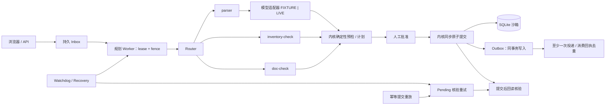

# order-ops-superagent

OrderOps SuperAgent：服装批发订单的多 Agent 调度系统，Router 分派解析、库存、单据核对子 Agent，人工审批后执行并核验。

**状态：v1.0.0 候选（1.0.0rc1）。Stage 1–4 已合入 main，Stage 5 冻结/交接 PR 已提出，等待 Qi 批准；尚未打正式 tag。**

已接通持久 inbox、worker、子 Agent 调度、预检、人工批准、原子提交、回读核验与 pending 核验重试，并支持静态文件上传、数据库任务视图及导出。默认 FIXTURE，可显式启用受预算限制的模型解析。

## 快速上手

需要 Python 3.11 及以上。本机演示只绑定 `127.0.0.1`，无需创建 `.env`。

```bash
python -m venv .venv
source .venv/bin/activate
pip install -e ".[dev]"
make init-db
make seed
make run
```

也可在激活虚拟环境后，用锁定依赖替代上面的安装命令：

```bash
pip install -r requirements-dev.lock && pip install --no-deps -e .
```

根目录 `requirements.lock` 是运行时依赖，`requirements-dev.lock` 是运行时与开发依赖；由 `uv pip compile pyproject.toml --universal --python-version 3.11`（开发版另加 `--extra dev`）生成，`pyproject.toml` 保留顶层依赖精确版本。

### 演示网页

激活虚拟环境、安装依赖后，运行：

```bash
make init-db && make seed && make run
```

打开 <http://127.0.0.1:8000/ui>。进入「提交改单」，选 `SO-1001`，粘贴黄金文案（表单已预填）：

```text
SO-1001 把未发的 40 件黑色 M 改成白色 M
```

点击「提交并查看任务」→「触发 worker 一次」→ 查看任务差量与下游影响 →「批准当前计划」→「提交生效」→ 查看 `operation_id`、`revision` 和核验结果。新初始化的合成库应得到 `SUCCEEDED`、revision `2`、核验 `passed`；点击订单号可查看当前行明细。首页也提供最近任务、示例订单和 `T-STUB` 桩任务入口。

默认 **FIXTURE**；网页 worker 端点强制使用 FIXTURE，未知文本不会触发 live。批准身份固定为服务端 `DEMO_ACTOR_ID`（`demo-user`），客户端不能指定 actor。仅用于 `127.0.0.1` 本机合成数据演示，非生产、不接真实 ERP。提交表单使用服务端渲染；批准、提交与 worker 交互需要浏览器启用 JavaScript。worker 每次只处理一条任务，不会自动批准或提交；已有其他任务时可重复点击。

已用 TestClient 验证表单、worker、批准/提交与结果回读。尚未在真实浏览器完成点选或截图，也未做完整无障碍、移动端及跨浏览器验证。

### 离线演示（FIXTURE）

保持默认 `OOS_LIVE_ENABLED=false`（已有环境若启用过 live，请先关闭并重启 API）。在另一个已激活虚拟环境的终端中：

```bash
curl -sS http://127.0.0.1:8000/health
curl -sS -X POST http://127.0.0.1:8000/inputs \
  -H 'Content-Type: application/json' \
  -d '{"thread_id":"stage5-demo","client_event_key":"stage5-demo-1","selected_order_id":"SO-1001","text":"SO-1001 把未发的 40 件黑色 M 改成白色 M"}'
python -m app.cli worker-once
```

记下入队回执的 `task_id`。在新初始化的合成库中，该任务处理后应到 `AWAITING_APPROVAL`；worker 不会自动批准或提交。FIXTURE 精确匹配上面的文本，未知文本不会自动转 live。同一 thread 内重复使用 `client_event_key` 会返回原任务。

- 状态：`http://127.0.0.1:8000/tasks/{task_id}`
- JSON 任务视图：`http://127.0.0.1:8000/tasks/{task_id}/view`
- HTML 任务页：`http://127.0.0.1:8000/ui/tasks/{task_id}`

用实际 ID 替换 `{task_id}`。任务页可查调度、来源、差量和批准状态，并通过按钮调用现有 [API](docs/API.md) 的 `POST /plans/{plan_id}/approve`、`POST /plans/{plan_id}/commit`。`T-STUB` 只是演示桩，批准按钮不可用。

独立运行完整的离线管道评测（含黄金链批准/提交）：

```bash
python scripts/eval_offline.py
```

`worker-once` 每次扫描恢复、处理一条任务并投递 outbox，可按需重复运行；没有常驻调度器。停止 API：在 `make run` 终端按 Ctrl+C。

### Fixture 与 Live（可选）

默认 **FIXTURE**，健康检查和任务卡标出模式。可选 live 使用 OpenAI Responses API，仓库配置推荐 `gpt-6-luna`；需显式启用并配置提供方、模型、输入/输出单价及运行时密钥。配置键见 [.env.example](.env.example)，以下价格占位符须替换为操作者确认的每百万 token 美元单价：

```bash
export OOS_LIVE_ENABLED=true
export OOS_LLM_PROVIDER=openai
export OOS_LLM_MODEL=gpt-6-luna
export OOS_LLM_BASE_URL=https://api.openai.com/v1
export OOS_PRICE_IN_PER_MTOK='<INPUT_USD_PER_MILLION_TOKENS>'
export OOS_PRICE_OUT_PER_MTOK='<OUTPUT_USD_PER_MILLION_TOKENS>'
export OOS_LIVE_BUDGET_USD=5.00
```

`OOS_LLM_API_KEY` **只在运行时通过进程环境注入**，不写入 `.env`、仓库、日志或提示词，绝不提交密钥。API 与 worker 须在相同配置环境下启动；缺单价或必需密钥时保持 FIXTURE。普通 live 预算为配置与 **$5** 的较小值，手动 smoke 另限 **$1**；调用前保守预留，超时/连接失败保留悲观估算，账本持久化。模型只能提议，批准、库存、版本与 fencing 检查由内核执行。

操作者完成配置后可手动运行（会调用 live，本次 Stage 5 未执行）：

```bash
.venv/bin/python scripts/live_smoke.py --out /tmp/oos_live_smoke.json
```

历史 live 样本与局限见 [LIVE_EVAL](docs/LIVE_EVAL.md)。CI 只用 fixture / MockTransport，不调用真实模型；离线通过率不代表模型理解质量。

## 架构



子 Agent 只出提案，不能批准或提交；内核重算库存和下游单据。lease / fence 用于规划任务，批准后的提交为同步事务，尚未排队独立 commit job。pending 核验重试不重新提交业务。详见[完整架构](ARCHITECTURE.md)与[架构决策记录](docs/ARCHITECTURE.md)（含早期阶段记录）。

## 测试与验证

```bash
make lint
make test
make typecheck
make cov
make check       # lint + typecheck + cov；覆盖率门槛 90%
python scripts/eval_offline.py
```

2026-11-06 本分支已验证（FIXTURE，无 live）：`make check` 全绿，ruff clean，mypy **61** 个源文件无问题，pytest **902 passed**，覆盖率 **95%**（TOTAL **4673** stmts，**233** miss；`fail_under=90`）。

离线评测 **50/50**：兜底能力 safeguards **23/23**（invalid_qty 8、unknown_order 7、injection 8）；管道回归 pipeline regression **27/27**（alias 9、ambiguous_wording 9、multi_line_change 8、golden 1）。它测的是给定 fixture 答案后的管道与内核，不测模型理解，范围见 [OFFLINE_EVAL](docs/OFFLINE_EVAL.md)。56 个 B/R 用例均已接入真实测试，当前没有占位跳过。

当前 `.github/workflows/ci.yml` 只跑 lint + test；typecheck、覆盖率、离线评测已暂存于 [待启用 CI](ci/pending-workflow-changes.yml)，等待 workflow 权限后启用。PR #9 已合入，离线脚本已在 main。

## 已知限制

- PR #19 已修复 watchdog / 幂等提交重放不补做 pending 核验的缺口。剩余：无常驻调度器，仅 `worker-once` / watchdog 或提交重放触发；持续失败无重试上限、退避、告警；watchdog/recovery/retry 无结构化日志；核验当前事实而非历史快照。跟踪于 [issue #20](https://github.com/baciozz/order-ops-superagent/issues/20)。
- SQLite 单写者、规划任务最多两条 RUNNING；完整聊天/澄清/审批 UI、生产认证和持久上传存储尚未完成。
- 未开裁同 SKU 生产单可扩量；已开裁单仍不能扩量，不自动新建生产单。补购只生成待供应商确认的草稿。
- FIXTURE 精确匹配；live 历史样本量小，兼容 provider 仅 mock 验证，通用表格布局尚未支持。

完整边界与交接文档延期项见[已知限制](docs/KNOWN_LIMITATIONS.md)。

## 后续路线

Stage 5 后跟进 [issue #20](https://github.com/baciozz/order-ops-superagent/issues/20)，启用待授权 CI，拆分 `app/services/kernel.py` 并解开 inbox/kernel 循环依赖；补全聊天与审批 UI、扩大 live 质量评测，再推进生产认证与存储。正式 v1.0.0 tag 须等 Qi 批准。

## 数据

全部是合成数据。默认库文件是 `./data/oos.db`（WAL，另有 `oos.db-wal` / `oos.db-shm`）。清掉演示数据：

```bash
rm -f data/oos.db data/oos.db-wal data/oos.db-shm
make seed
```

`make seed` 再次执行不会复制订单。库里已经有 `SO-1001` 时会直接返回。

## 替换模型

兼容 Chat（DeepSeek / vLLM / Ollama）使用 `OOS_LLM_PROVIDER=openai_compatible`，显式配置 `OOS_LLM_BASE_URL`、`OOS_LLM_MODEL` 与输入/输出单价；本地免费模型也须显式填 `0`。远端须 HTTPS 和运行时密钥，仅 `localhost`、`127.0.0.1`、`::1` 允许 HTTP 和免密钥，按主机名字符串判定。操作者配置的任何 HTTPS 地址都会收到 key。

`OOS_LLM_JSON_SCHEMA_SUPPORTED` 默认 `false`（`json_object`），确认支持严格 `json_schema` 后才设为 `true`。兼容 provider 仅 mock 验证，不发送 `store`，是否留存数据取决于提供方；具体配置与错误码见[模型提供方](docs/MODEL_PROVIDERS.md)。

## 禁区

不连接真实 ERP、客户、支付、合同或发货接口。不公开部署。仓库保持私有，直到方案修订第 6 条的公开条件满足。批准和提交只作用于本机沙箱。

## 文档

- [CHANGELOG / 版本交接](CHANGELOG.md)
- [方案 v1.0](docs/PLAN_v1.0_dot.md) 与 [修订 v1.1](docs/PLAN_REVISION.md)（原文）
- [完整架构](ARCHITECTURE.md)与[架构决策记录](docs/ARCHITECTURE.md)
- [接口契约](docs/API.md)
- [子 Agent 契约](docs/SUBAGENTS.md)
- [已知限制](docs/KNOWN_LIMITATIONS.md)
- [测试清单](docs/TEST_CHECKLIST.md)
- [离线评测](docs/OFFLINE_EVAL.md)与[历史 Live 评测](docs/LIVE_EVAL.md)
