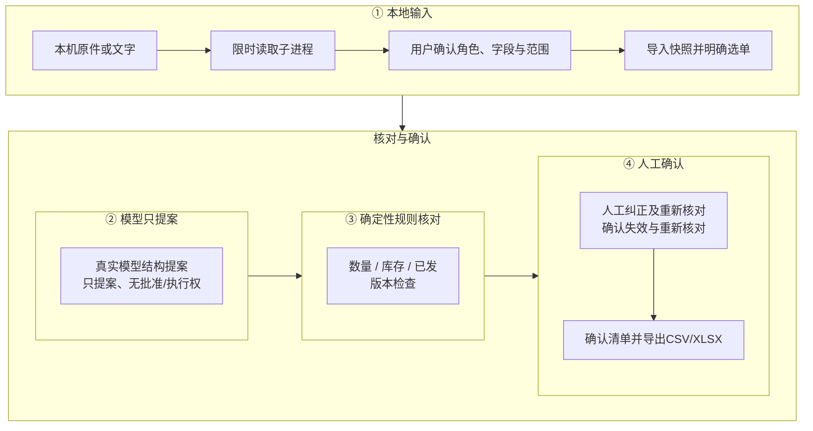
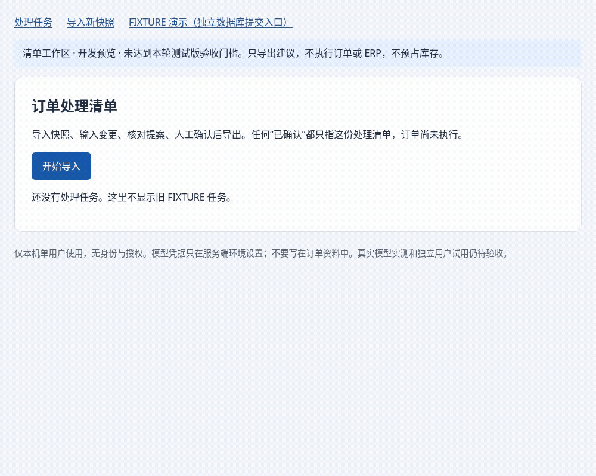

# OrderOps：本机订单变更核对助手

服装批发客户改单时，需要逐项对照订单、库存和已发货快照。<br>
模型只输出结构化提案，无批准或执行权。<br>
确定性规则核对并经人工确认后导出清单，不执行订单；当前为**私有开发预览、未发布**。





合成数据，无模型调用，清单未执行订单

## 安装和启动

主要支持路径是源码安装；本轮实际验证Linux/Python3.12，项目声明最低Python3.11，其他平台未完整验收。首次依赖下载与模型配置不计入五分钟演示。请在新的本地目录使用合成资料，不在生产数据库运行初始化。

```bash
python -m venv .venv
.venv/bin/python -m pip install -r requirements-build.lock -r requirements.lock
.venv/bin/python -m pip install --no-deps --no-build-isolation -e .
mkdir -m 700 local-preview
export OOS_DATABASE_URL="sqlite:///$PWD/local-preview/review.db"
export OOS_LIVE_ENABLED=false
.venv/bin/python -m app.cli init-db
.venv/bin/python -m uvicorn app.main:app --host 127.0.0.1 --port 8000
```

打开 <http://127.0.0.1:8000/ui/reviews>，选择“导入新快照”。可以先用页面预填合成JSON保存需求，或从空白文件工作区上传订单基线、库存/履约文件及客户要求。普通清单无需seed；示例JSON不是已登记的解析答案。

第一次使用、暂不连接模型时，可按[无需模型的合成示例](docs/OFFLINE_WALKTHROUGH.zh-CN.md)在全新隔离目录启动，人工录入 36 件并核对 50 → 36、差量 −14，再确认和下载。该演示不执行订单，也不是模型识别成绩。

后续维护和评测交接请先读[接手交接](docs/HANDOFF_TO_NEXT_MODEL.zh-CN.md)。

1. 核对原件和列映射，应用业务基线并明确选择订单；不能按文件名猜用途或把未知当零。
2. 配好服务端模型后，确认资料传输与费用再提取；无密钥时可直接用“人工输入/纠正”演示规则，但不能当作模型成绩。
3. 逐行核对旧量、新量、差量、来源和缺失事实。修改或新增资料会使旧确认失效。
4. 确认处理清单后下载CSV/XLSX。清单仍未执行订单，使用前须核对最新业务事实。

[本机使用与恢复](docs/LOCAL_BETA_GUIDE.zh-CN.md)说明模型配置、错误恢复及数据保留；[输入支持矩阵](docs/beta/INPUT_SUPPORT.zh-CN.md)列编码、Excel布局、大小/页数上限和可选中文OCR准备。图片需要本机Tesseract及明确安装的中文语言数据，权重不随项目分发。

## 范围与验证

只面向本机单用户，默认监听127.0.0.1；没有身份/订单授权，Host校验不是认证。尚未证明真实ERP、完整来源父链与共享依赖，也不支持对外或多人部署。只读清单与旧FIXTURE演示库的审批/提交是两个入口，不能把真实导入资料自动送入演示提交。

- [架构与API](docs/LOCAL_BETA_ARCHITECTURE.zh-CN.md)：单模型提案、确定性检查及人工确认；现有“多Agent”节点不代表多模型并行优势。
- [合成数据与参考边界](docs/beta/DATASET.zh-CN.md)、[AI参考复核](docs/beta/AI_LABEL_REVIEW.zh-CN.md)：360功能+60风险，独立人工复核仍待签。
- [安装实测](docs/beta/ONBOARDING_SOURCE_CHECK.zh-CN.md)、[浏览器实测](docs/beta/BROWSER_EDITOR_CHECK.zh-CN.md)与[已知限制](docs/LOCAL_BETA_LIMITATIONS.zh-CN.md)；没有未实测平台的承诺。
- 旧演示请用[五分钟FIXTURE业务演示](docs/FIVE_MINUTE_DEMO.zh-CN.md)；它测固定业务链，不测自由语言理解。

开发者安装`requirements-dev.lock`并运行`make check`、`make eval-offline`。普通CI离线且不持有付费模型密钥；真实评测须单独授权、固定版本、共用预算账本。当前包内`1.0.0rc1`是历史版本号，不代表本轮发布资格。

仓库已有[MIT许可证](LICENSE)，版权归属、维护者联系方式及拟公开内容仍须所有者最终确认；第三方组件单独保留其声明。不会自动公开仓库、打正式tag或创建Release。[历史README](docs/history/README_PRE_BETA_1e63f7c.md)保留旧工程交接细节。
