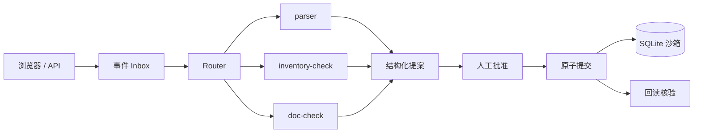

# order-ops-superagent

OrderOps SuperAgent：服装批发订单的多 Agent 调度系统，Router 分派解析、库存、单据核对子 Agent，人工审批后执行并核验。

OrderOps SuperAgent: a multi-agent coordination layer for garment-wholesale order changes.

**状态：Stage 1C（子 Agent 接口）在当前分支。** `POST /dispatch` 用 Fixture 跑 parser、inventory-check、doc-check，再进入已有的预检、批准、提交和回读核验。不调用 live 模型。持久任务和完整界面还没做。

## 架构



子 Agent 只出提案，不能批准或提交。内核在批准后的提交里重算库存和下游单据。inbox、租约和完整任务页还没接上。

## 如何运行

需要 Python 3.11 及以上。本机演示只绑定 `127.0.0.1`。

```bash
python -m venv .venv
source .venv/bin/activate
pip install -e ".[dev]"
make seed
make run
```

- 健康检查：<http://127.0.0.1:8000/health>
- 任务视图桩：<http://127.0.0.1:8000/tasks/T-STUB/view>
- 同一结构的朴素页面：<http://127.0.0.1:8000/ui/tasks/T-STUB>

等价脚本：`scripts/seed.sh`、`scripts/run.sh`、`scripts/test.sh`、`scripts/lint.sh`。

停止：在运行 `make run` 的终端按 Ctrl+C。Stage 0 没有后台 worker，也没有常驻的模型调用。

## 测试

```bash
make lint
make test
```

`pytest` 会列出跳过的 B/R 用例和原因。跳过不是通过。清单在 `tests/acceptance_cases.py`。

## 数据

全部是合成数据。默认库文件是 `./data/oos.db`（WAL，另有 `oos.db-wal` / `oos.db-shm`）。清掉演示数据：

```bash
rm -f data/oos.db data/oos.db-wal data/oos.db-shm
make seed
```

`make seed` 再次执行不会复制订单。库里已经有 `SO-1001` 时会直接返回。

## Fixture 与 Live

默认 `FIXTURE`。`/health` 和任务卡都会标出模式。

Live 需要同时具备 `OOS_LIVE_ENABLED=true`、输入/输出单价和 `OOS_LLM_API_KEY`。单价缺失时不猜测，进程保持 FIXTURE。有效预算是配置值与 **5.00 美元** 里较小的那个。账本在 `model_usage` 表，重启不清零。Stage 0 没有 live HTTP 传输：守卫通过后会明确失败，不会访问网络。

配置键见 `.env.example`。不要提交 `.env`，不要把密钥写进仓库或提示词。

## 禁区

不连接真实 ERP、客户、支付、合同或发货接口。不公开部署。仓库保持私有，直到方案修订第 6 条的公开条件满足。批准和提交只作用于本机沙箱。

## 文档

- [方案 v1.0](docs/PLAN_v1.0_dot.md) 与 [修订 v1.1](docs/PLAN_REVISION.md)（原文）
- [架构与本阶段决策](docs/ARCHITECTURE.md)
- [接口契约](docs/API.md)
- [子 Agent 契约](docs/SUBAGENTS.md)
- [已知限制](docs/KNOWN_LIMITATIONS.md)
- [测试清单](docs/TEST_CHECKLIST.md)
