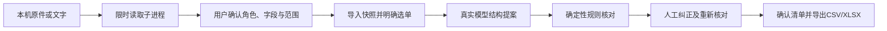

# 清单工作区架构与接口

读取进程不继承模型密钥；真实字节、提取定位、人工转录和未采用资料分别记录。模型只收到所选快照与已确认客户来源，无Oracle、渲染底稿或测试标签。持久工作区使用版本与调用nonce防止迟到结果覆盖新状态；费用在发送前由持久账本原子预留，未知账单保留悲观费用。历史库不被自动认证。

处理清单不会创建可执行业务Plan/Approval/Operation。旧FIXTURE业务演示有独立的审批、提交与限定范围核验；“partial”只表示覆盖字段一致，完整父来源和共享依赖未证明，不能改称全库通过。技术调度中parser调用模型，inventory-check和doc-check是顺序确定性工具节点，不构成已测的多模型并行方案。详细旧业务内核见根目录ARCHITECTURE.md。

## 主要API（本机，无认证授权）

| 操作 | 接口 | 语义 |
| --- | --- | --- |
| 新建JSON快照任务 | POST /reviews | 明确选中订单和需求，按request_key去重 |
| 空白文件工作区 | POST /reviews/drafts | 初始无订单，不带演示订单猜测 |
| 查看/列表 | GET /reviews/{id}，GET /ui/reviews | API与页面共享持久状态 |
| 上传原件 | POST /reviews/{id}/sources | multipart文件、revision、key；默认未知角色 |
| 确认角色与映射 | POST /reviews/{id}/sources/{source}/confirm | 关键字段/范围确认，不能以上传成功代替 |
| 人工转录/同哈希恢复 | POST /reviews/{id}/sources/{source}/correct 或 restore | 保留原读取，修改作废旧确认；恢复不能替换新内容 |
| 应用基线/选单 | POST /reviews/{id}/sources/apply-baseline，POST /reviews/{id}/select-order | 先确认资料再明确选目标 |
| 更新客户文字 | POST /reviews/{id}/instruction | 仅本任务澄清，作废旧结果 |
| 真实模型提取 | POST /reviews/{id}/extract | 明确传输确认、request_key、revision；严格配置检查 |
| 多动作人工纠正 | POST /reviews/{id}/correct | 完整Proposal和修改理由；重新运行规则 |
| 确认/取消/恢复 | POST /reviews/{id}/confirm、cancel、recover | 版本保护；确认清单不执行订单 |
| 导出 | GET /reviews/{id}/export?fmt=csv 或 xlsx | 仅已确认且来源仍完整的当前清单 |

结构以app/review/contracts.py、assets.py和路由声明为准；未知字段、错单、过期版本、未确认来源、非法单位或业务约束会拒绝。正文与原件不得包含API密钥。没有对外账户/订单级授权，127.0.0.1及Host检查不代替认证，不开放多用户服务。
